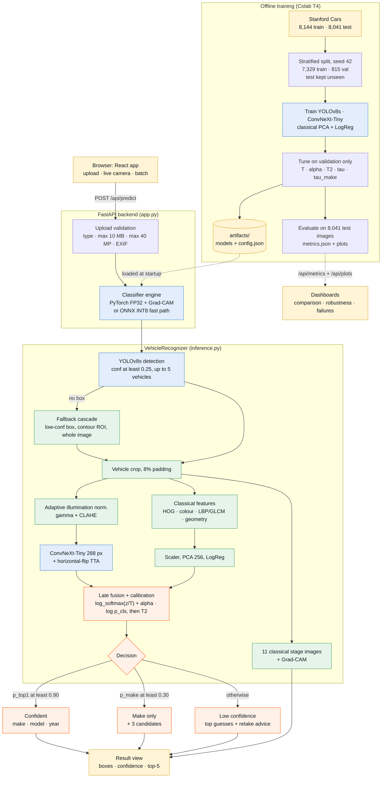

# Hackathon Technical Solution Report

| Field | Details |
| :--- | :--- |
| **Problem ID** | `P5` |
| **Problem Title** | Intelligent Fine-Grained Vehicle Recognition and Analysis System |
| **Team Name** | T75 |
| **Team Members** | Harshith K T (1RUA24CSE0156) · Himavanth Gowda R S (1RUA24CSE0164) · Kishan Yadav C (1RUA24CSE0205) |
| **GitHub Repository** | https://github.com/Harshithkt/car-evals (code evaluated at commit `91c48ec`) |
| **Live Demo / Deployment** | https://harshithkt06--p5-vehicle-app-web.us-east.modal.run (FastAPI + React on Modal, CPU) |

The full metric tables are in [`eval_P5_T75.md`](eval_P5_T75.md). The raw numbers are in [`artifacts/metrics.json`](artifacts/metrics.json).

---

## 1. Problem Understanding & Solution Strategy

### Core Technical Challenge

From one photo, the system must find the vehicle and name its **make, model and year** out of **196 Stanford Cars classes** (49 makes, 189 make + model groups, model years 1991–2012). The main difficulties:

- **Small differences between classes.** Many classes differ only in small details:
  - Year facelifts: Bentley Continental GT 2007 vs 2012, Dodge Caliber 2007 vs 2012. Seven make + model groups appear in more than one year.
  - Trim levels: Audi A5 vs S5, Silverado 1500 vs 2500HD.
  - Body styles: Ferrari 458 coupe vs convertible.
  - Rebadged twins sold by different makes: Chevrolet Express vs GMC Savana, Dodge vs Mercedes-Benz Sprinter.
- **Large variation within a class.** The same class appears from front, side and rear views, in daylight and indoor showrooms, at 100 px to 1,000 px+, and partly cut off by the frame.
- **Little data.** About 37 training images per class (7,329 training images in total), so the classifier must rely on transfer learning.
- **Localisation is required.** Every prediction needs a bounding box, and the classifier must see the vehicle, not the background.
- **Closed set.** Any car outside the 196 classes will be forced onto the nearest class, so the system has to communicate how unsure it is.

**Target constraints.**
- The app runs on a public URL, on **CPU only** (2 vCPU, 4 GiB, scale-to-zero) to keep hosting cost near zero.
- It should respond within about 10 s.
- It must work on a phone.
- Upload size and format must be validated.
- Thresholds and calibration must be chosen without touching the test set.

### Proposed Methodology

We use a **cascade**:
1. A fine-tuned **YOLOv8s** localises each vehicle. Classical fallbacks take over when it finds nothing.
2. A **classical adaptive illumination normalisation** prepares the crop.
3. A **ConvNeXt-Tiny** fine-grained classifier labels the crop.
4. The classifier's scores are **late-fused** with a classifier trained on hand-crafted HOG / colour / texture / geometry features.
5. The fused scores are **temperature-calibrated**.
6. A **three-tier decision** returns one of: the full make / model / year; the make only; or a low-confidence notice.

We chose this cascade over a single static model for four reasons:
- Detection-then-classification gives the classifier a tight, consistent crop: +3.2 pt top-1 over classifying the whole image.
- The classical modules give fallbacks and interpretable intermediate results.
- Calibration makes the confidence value meaningful.
- The confidence value is what lets the system say "I'm not sure about the year" instead of failing silently.

---

## 2. Technical Architecture & Implementation

### System architecture (matches the code at commit `91c48ec`)



Colour key: yellow is an input or output, green is classical computer vision, blue is a learned model, orange is hybrid fusion and decision. Solid arrows are the request path and dotted arrows are the offline files and metrics. Static copies of this diagram: [`docs/architecture.svg`](docs/architecture.svg) and [`docs/architecture.png`](docs/architecture.png).

| Module | Responsibility |
|---|---|
| [`artifacts/classical_cv.py`](artifacts/classical_cv.py) | Preprocessing and normalisation, adaptive illumination correction, auto-Canny edges, morphological closing, contour analysis, classical vehicle ROI, HOG / colour / LBP / GLCM / geometric features, intermediate-stage images |
| [`artifacts/inference.py`](artifacts/inference.py) | `VehicleRecognizer`: detection with fallbacks → classification (illumination norm. + TTA + fusion + calibration) → three-tier decision → annotated image → Grad-CAM |
| [`backend/app.py`](backend/app.py) | FastAPI: upload validation, two loaded engines (PyTorch FP32 and ONNX INT8), `/api/predict`, `/api/metrics`, `/api/classes`, `/api/plots`, `/api/samples`, `/api/health`, serves the built frontend |
| [`frontend/src/`](frontend/src/) | React app. 10 pages: upload / camera recognition, batch analysis with CSV export, stress lab, pipeline stages, model comparison, robustness and confidence, failure analysis, class catalogue, requirement checklist |
| [`notebook/P5_Vehicle_Recognition.ipynb`](notebook/P5_Vehicle_Recognition.ipynb) | Data split, classical module, YOLO fine-tuning, ConvNeXt training, hybrid fusion, ablation, approach comparison |
| [`notebook/P5_Evaluation_Remaining.ipynb`](notebook/P5_Evaluation_Remaining.ipynb) | Loads the trained models (no training). Similar-class analysis, robustness suite, calibration and thresholds, optimisation, failure analysis |
| [`modal_app/deploy.py`](modal_app/deploy.py), [`Dockerfile`](Dockerfile) | Hosting: single CPU container serving API + frontend |

### 2.1 Classical Algorithmic Baseline

**Algorithms used** (all in `classical_cv.py`):

| Requirement (PS §3A) | Implementation |
|---|---|
| Image preprocessing and normalisation | Aspect-preserving resize (`INTER_AREA`); per-channel **z-score** normalisation; **adaptive gamma + CLAHE** on the LAB lightness channel; BGR/RGB/RGBA/grayscale input handling |
| Edge detection and contour analysis | Gaussian blur (5×5) → **auto-threshold Canny** → **morphological closing** (7×7 rectangular kernel, 2 iterations) + dilation → external contours. Measured per contour: area, extent, solidity (area / convex-hull area), circularity 4πA/P², aspect ratio |
| Colour and texture feature extraction | **Colour:** HSV histograms (18 hue, 8 saturation, 8 value bins) plus LAB mean and standard deviation. **Texture:** uniform **LBP** histograms at (P, R) = (8, 1) and (16, 2), and **GLCM** contrast / dissimilarity / homogeneity / energy / correlation at 2 distances × 4 angles |
| Region-of-interest extraction | **Classical contour ROI:** CLAHE → edges → closing → choose the contour with the best score = area × (0.5 + 0.5 · centrality) × aspect-ratio prior. Used as a detector fallback and as an ablation localiser |
| Geometric feature analysis | ROI aspect ratio, edge density, contour count, solidity, extent, circularity, 7 log-scaled **Hu moments**, 8-bin gradient-orientation histogram, **left–right symmetry** of the edge map |
| Shape descriptor | **HOG** on a 160 × 96 grayscale crop (9 orientations, 16 px cells, 2 × 2 blocks, L2-Hys) |

The full descriptor has about 1.75k dimensions. It goes through StandardScaler → PCA (256 components) → multinomial **Logistic Regression** (C = 0.5). We use LogReg rather than the stronger RBF-SVM because fusion needs calibrated log-probabilities. The SVM is reported for comparison: 20.9% vs 14.7% top-1.

**Adaptive parameter selection.** Parameters are computed from each image's statistics instead of being fixed:
- **Illumination:** the mean HSV value *V* of the crop selects the branch.
  - *V* < 80 (dark): gamma γ = max(0.4, V / 80) is applied through a lookup table, which lifts the shadows more the darker the image is. Then CLAHE with clip limit 2.5.
  - *V* > 200 (washed out): CLAHE with clip limit 1.5 only, to restore local contrast without boosting noise.
  - Otherwise the crop is left unchanged.
- **Canny thresholds** come from the median intensity *m*: low = (1 − 0.33)·*m*, high = (1 + 0.33)·*m*. The same code then works on dark and bright images.
- **ROI scoring** rejects contours smaller than 5% of the image. It weights centrality and down-weights boxes outside a car-like aspect ratio of 0.8–3.5.
- **Detector fallbacks** are chosen at run time. The cascade is: YOLO box with confidence ≥ 0.25 → best YOLO box below 0.25 → classical contour ROI → whole image. Which source was used (`det_source`) is returned and shown in the UI.

### 2.2 Deep Learning Pipeline

**Model architecture and rationale.**

| Component | Choice | Why |
|---|---|---|
| Detector (PS §3B: YOLO / R-CNN) | **YOLOv8s** (11.1 M params, 22.5 MB), COCO-pretrained, fine-tuned as a single class `car` on Stanford Cars boxes | Real-time on CPU (about 38 ms/img on a laptop). Fine-tuning raised mAP@0.5 from 0.858 (zero-shot COCO) to 0.990 and mean IoU from 0.870 to 0.954 |
| Fine-grained classifier (PS §3B: CNN / ViT) | **ConvNeXt-Tiny** (`convnext_tiny.fb_in22k_ft_in1k`, 28.0 M params), ImageNet-22k pretrained, new 196-way head | ImageNet-22k pretraining transfers well to fine-grained categories. A convolutional prior trains well from only ~37 images per class, whereas ViTs typically need more data or heavier regularisation. Trains in ~46 min on a T4. Gives clean Grad-CAM maps. Exports to ONNX and quantises to INT8 with no loss in accuracy |

**Losses and training.**
- **Classifier:**
  - Loss: cross-entropy with **label smoothing 0.1**.
  - Optimiser: AdamW (backbone learning rate 2e-4, head 1e-3, weight decay 0.05), 1-epoch linear warm-up then cosine decay.
  - Batch 32 at 288 px for 20 epochs, mixed precision (FP16), gradient clipping at 1.0, stochastic depth 0.1.
  - Inputs: ground-truth crops with 8% padding.
  - Checkpoint: the best by validation top-1 (94.85%, epoch 17).
- **Augmentations**, each aimed at a requirement in PS §4:

  | Requirement | Augmentations |
  |---|---|
  | Illumination | ColorJitter (brightness 0.4, contrast 0.4, saturation 0.3, hue 0.03), p = 0.8; grayscale, p = 0.05 |
  | Viewing angle | RandomResizedCrop (scale 0.6–1.0); horizontal flip; perspective 0.25, p = 0.3; rotation ±10°, p = 0.3 |
  | Resolution | Random down-scale to ×0.2–0.6 and back, p = 0.2; Gaussian blur, p = 0.15 |
  | Occlusion | Random erasing of 2–25% of the image, p = 0.35 |

  Examples of augmented crops are in `plots/augmentations.png`.
- **Detector:** standard Ultralytics loss (CIoU + DFL box loss, BCE objectness / class loss). 15 epochs at 640 px, batch 16, cosine learning rate, early-stopping patience 5. Validated on the same 815-image validation split.
- **Data split (no leakage).**
  - The official train set (8,144) is split 90 / 10, **stratified by class** (seed 42), into **7,329 train / 815 validation**.
  - The **official test set (8,041) is used only for final evaluation**. Model selection, temperatures, fusion weight and thresholds all come from validation.
  - The *evaluation* notebook reproduces the same split with the same seed.

### 2.3 Hybrid Integration & Adaptive Mechanism

**Fusion strategy.** Classical processing feeds the network at three points:
1. **Localisation prior.** The classical contour ROI is the fallback when YOLO finds nothing. In the ablation, it alone lifts the classifier from 91.42% (whole image) to 92.54%.
2. **Illumination prior.** The adaptive gamma + CLAHE correction is applied to every crop *before* the CNN.
3. **Feature-level evidence.** The classical classifier's log-probabilities are added to the CNN's tempered log-probabilities:

   s = log softmax(z / T) + α · log p_classical,   p = softmax(s / T₂)

   - **T = 0.695** is fitted by L-BFGS on validation NLL. T < 1 *sharpens* the logits: label smoothing makes the raw network systematically **under-confident**, which is why the raw ECE is 13.4%.
   - **α = 0.05** is selected by grid search on validation top-1 over 0–1 in steps of 0.05 (`plots/fusion_alpha.png`).
   - **T₂ = 1.034** re-calibrates the fused score.

   Because α is small, the classical model *nudges* close calls rather than overriding the CNN. That is the right weight for a model that gets 14.7% top-1 on its own.

The same crop also generates the **11 intermediate stage images** and the classical feature read-out (brightness, illumination fix applied, edge density, contour count, solidity, symmetry, mean colour, ROI score). Both are shown in the app.

**Decision logic (low-confidence handling, PS §3C).** The calibrated distribution *p* over the 196 classes is also summed per make: p_make(m) = Σ p(c) over the classes c of make m. Thresholds were picked **on validation**:
- **τ** is the lowest threshold ≥ 0.30 that gives at least 99% accuracy on accepted predictions.
- **τ_make** is the lowest that gives at least 98% make accuracy.

| Condition | Output | Test share | Accuracy |
|---|---|---:|---:|
| p_top1 ≥ τ = 0.90 | **Confident:** make · model · year + confidence | 87.1% | 97.8% (make 99.7%) |
| p_top1 < 0.90, max p_make ≥ τ_make = 0.30 | **Uncertain model:** "Likely a {make} (x%); exact model/year uncertain" + 3 candidates | 12.3% | make 92.3% |
| otherwise | **Low confidence:** "try a clearer / closer image" + top guesses | 0.5% | 34.1% |

Box colour follows the tier: green for confident, orange for uncertain model, red for low confidence. A **"Why not the runner-up?"** panel explains the margin to the closest rival class. A **threshold playground** lets the user move τ and τ_make and see the effect, using the deployed rule. Aggregating to the make is how the system handles visually similar models: when two Audi coupés are close, it still commits to the make, where it is 92–99% correct, without guessing the model.

---

## 3. Experimental Benchmarks & Evaluation

### 3.1 Quantitative Benchmarks

PSNR / SSIM / LPIPS in the template are image-enhancement metrics. For P5 we report the metrics the problem statement requires. All numbers are on the **8,041 unseen test images** unless marked otherwise.

**(a) Classical vs deep learning vs hybrid** (same YOLO ROI for every row, so only the classifier changes):

| Approach / Model Variant | Top-1 ↑ | Top-5 ↑ | Make acc. ↑ | Make + Model ↑ | Size | Latency (ms / image, T4) |
| :--- | :---: | :---: | :---: | :---: | :---: | :---: |
| **Classical baseline** (HOG + colour + texture + geometry → LogReg) | 14.74% | 35.59% | 24.26% | 15.18% | 24.8 MB | 41.1 |
| **Deep learning only** (YOLO + ConvNeXt-Tiny) | 94.63% | 99.30% | 98.30% | 95.17% | 134.5 MB | 34.8 |
| **Proposed hybrid system** | **94.66%** | **99.35%** | **98.41%** | **95.22%** | 136.7 MB (58.7 MB with INT8) | 87.3 |

**(b) Localisation and detection:**

| Localiser | mAP@0.5 ↑ | mAP@0.5:0.95 ↑ | Mean IoU ↑ | IoU ≥ 0.5 ↑ |
| :--- | :---: | :---: | :---: | :---: |
| Classical contour ROI | 0.568 | 0.179 | 0.629 | 75.3% |
| YOLOv8s COCO zero-shot | 0.858 | 0.785 | 0.870 | 91.4% |
| **YOLOv8s fine-tuned (deployed)** | **0.990** (Ultralytics: 0.995) | **0.934** (0.937) | **0.954** | **99.9%** |

**(c) Efficiency and optimisation** (PS §4.6):
- **ONNX dynamic INT8 quantisation** shrinks the classifier from **111.9 MB to 34.0 MB (3.3×)** with top-1 94.6% → 94.7% (1,000 test crops).
- On an Apple M5 CPU the whole pipeline takes **105 ms/image with INT8 vs 677 ms with FP32** (classification 67 vs 639 ms).
- FP16 halves the size (56.0 MB) at the same accuracy.
- Global L1 pruning without fine-tuning: 91.8% at 30% sparsity; collapses to 16.5% at 50%.

**(d) Calibration:** ECE 13.36% (raw) → 1.60% (temperature) → **1.73%** (final hybrid).

**Analysis.**
- **Accuracy comes from the CNN and detector.** Hand-crafted features reach only 14.7% on 196 look-alike classes, because HOG / colour / texture describe silhouette and paint, not badges or lamp shapes.
- **The hybrid's accuracy gain over deep-only is real but tiny.** It is +0.04 pt top-1 (3 of 8,041 images) and +0.11 pt make, and in the robustness suite the hybrid is within ±0.5 pt of deep-only. It roughly doubles GPU latency (TTA + feature extraction).
- **What the hybrid adds** is a working fallback chain, interpretable intermediate results, and calibrated confidence. Calibration lets 87% of predictions be shown with 97.8% accuracy while the rest abstain to make level.
- **Efficiency:** INT8 is the better trade-off on CPU: 6.4× faster end-to-end on a laptop, 3.3× smaller, same accuracy. The live app therefore uses INT8 for the camera and batch modes, and FP32 only when Grad-CAM is requested.

### 3.2 Visual Outputs & Intermediate Representations

The figures are image files in the repository, linked below. The notebooks regenerate them.

| Template asks for | File | What it shows |
|---|---|---|
| Extreme conditions (dark, very dark, over-exposed, low contrast, blur, noise, rotation, occlusion, low resolution) | [`plots/robustness_examples.png`](plots/robustness_examples.png) | One test image under each condition, with the top-1 accuracy under that condition |
| | [`plots/robustness_bars.png`](plots/robustness_bars.png) | Top-1 for deep only, hybrid, and hybrid with illumination normalisation, per condition |
| | [`plots/slices.png`](plots/slices.png) | Top-1 and IoU by viewing angle, vehicle resolution and brightness |
| Intermediate states | [`plots/pipeline_stages.png`](plots/pipeline_stages.png) | The 11 stage images that `/api/predict` returns for every upload |
| | [`plots/classical_stages.png`](plots/classical_stages.png) | The classical module on a test image (Toyota Camry Sedan 2012) |
| Localisation | [`plots/detection_examples.png`](plots/detection_examples.png) | Ground truth (green), classical ROI (blue), COCO YOLO (yellow), fine-tuned YOLO (red) |
| Confidence | [`plots/reliability.png`](plots/reliability.png) | Reliability diagrams: raw, temperature scaled, final hybrid |
| | [`plots/threshold_analysis.png`](plots/threshold_analysis.png) | Accuracy and coverage against the threshold; confidence of right and wrong answers |
| Comparison and tuning | [`plots/approach_comparison.png`](plots/approach_comparison.png) | Classical vs deep vs hybrid |
| | [`plots/optimization.png`](plots/optimization.png) | Size and top-1 for each optimisation variant |
| | [`plots/fusion_alpha.png`](plots/fusion_alpha.png) | Validation top-1 against the fusion weight α |
| | [`plots/training_curves.png`](plots/training_curves.png) | Training loss and validation accuracy over 20 epochs |
| Dataset and training | [`plots/eda_samples.png`](plots/eda_samples.png), [`plots/eda_stats.png`](plots/eda_stats.png), [`plots/augmentations.png`](plots/augmentations.png) | Training examples with boxes, dataset statistics, training augmentations |
| Failures | [`plots/error_hierarchy.png`](plots/error_hierarchy.png), [`plots/failure_causes.png`](plots/failure_causes.png), [`plots/failure_gallery.png`](plots/failure_gallery.png), [`plots/confused_pair.png`](plots/confused_pair.png) | Error types, causes, the most confident errors with Grad-CAM, and the most confused pair |
| The deployed app | [`docs/screenshots/`](docs/screenshots/) | Recognize, explain (runner-up and threshold playground), stress lab, comparison, robustness, camera and batch pages |

### 3.3 Ablation Study

Each row adds or removes one component (8,041 test images):

| Configuration | Top-1 | Top-5 | Make | Δ top-1 |
|---|---:|---:|---:|---:|
| Deep: whole image (no detection) | 91.42% | 98.05% | 95.83% | baseline |
| + classical contour ROI | 92.54% | 98.35% | 96.68% | **+1.12** |
| YOLO ROI instead | 94.63% | 99.30% | 98.30% | **+3.21** |
| + flip TTA | 94.68% | 99.35% | 98.36% | +0.05 |
| + adaptive illumination norm. | 94.66% | 99.35% | 98.35% | −0.01 |
| **+ classical feature fusion (final hybrid)** | **94.66%** | **99.35%** | **98.41%** | 0.00 (make +0.06) |
| Final without illumination norm. | 94.68% | 99.35% | 98.42% | +0.01 |
| Final without TTA | 94.60% | 99.25% | 98.35% | −0.06 |
| Reference: deep on ground-truth crops | 94.55% | 99.33% | 98.33% | −0.11 vs final |
| Classical features only (LogReg / RBF-SVM) | 14.74% / 20.89% | 35.59% / 40.63% | 24.26% / 31.99% | −79.9 / −73.8 |

**Findings.**
1. **Localisation is the most valuable component** (+3.21 pt). Fine-tuned YOLO crops even beat ground-truth crops by 0.07 pt, because its boxes are tight and consistent.
2. **TTA** is a small but consistent gain on every metric.
3. **Classical fusion** helps make accuracy only.
4. **Illumination normalisation is fixed-vs-adaptive in action.** It is neutral on clean images, because by design it does nothing when 80 ≤ V ≤ 200. It helps under extreme darkness (very dark: 93.5% → 94.0%), but slightly hurts under moderate uniform darkening (dark: 94.3% → 93.8%), because the network already learned that case from ColorJitter.
5. **Robustness** (1,000 test images, perturbed before detection; full table in `eval_P5_T75.md` §5): illumination changes cost ≤ 1.6 pt and rotation 1.9 pt. Occlusion of 25% / 40% of the box costs 4.9 / 10.1 pt. Only ×0.1 resolution breaks the system (58.9%).

---

## 4. Failure Modes & Limitations

The final system makes **429 errors on 8,041 test images**. Each was tagged with one cause: same-make sibling 51.0%, cross-make look-alike 22.8%, truncation 9.1%, year 8.6%, low resolution 6.5%, low light 1.4%, localisation 0.5%. The most confident errors, with Grad-CAM, are in `plots/failure_gallery.png`. The split by cause is in `plots/failure_causes.png` and `plots/error_hierarchy.png`.

### Observed Failure Cases

**Failure 1: Model-year facelifts.** *Bentley Continental GT Coupe 2012 → 2007 (99.8% confident); Dodge Caliber Wagon 2012 → 2007 (13 test images).*
- **Root cause:** the generations share the body shell. They differ in headlamp internals, bumper and tail-lamp graphics, which cover about 2–5% of the crop. ConvNeXt's global average pooling mixes these few discriminative positions with the much larger shared body, so the two class scores barely separate. The training labels are hard one-hot targets for a distinction the 288 px input barely resolves.
- **Mitigation:**
  - Attention-guided second crops at higher resolution (e.g. WS-DAN-style crop of the Grad-CAM peak).
  - A hierarchical make → model → year head, so year errors cost less than model errors.
  - Larger input (384 px) for the final stage.

**Failure 2: Rebadged twins across makes, and label noise.** *Chevrolet Express Cargo Van → GMC Savana Van (99.8%); Dodge Sprinter → Mercedes-Benz Sprinter (10 images); Chrysler Town & Country → Ram C/V.*
- **Root cause:** these are the same physical vehicle sold under two badges. The badge is the only reliable cue and it is a few dozen pixels. In the gallery example the image labelled "Chevrolet" visibly carries a **GMC grille**, and Grad-CAM focuses on that grille. So part of this error class is **dataset label noise**, not a model error. The two Chevrolet Express vans (cargo vs passenger) are the hardest classes (55% / 57%), because they differ mainly in side windows.
- **Mitigation:**
  - A small badge / logo detector as an extra cue.
  - Label cleaning (confident-learning style audit of high-confidence disagreements).
  - Reporting twin groups ("GM full-size van") when the two are confused.

**Failure 3: Extreme low resolution.** *Resolution ×0.1: top-1 58.9%, make 66.7% (vs 94.7% / 99.3% clean); localisation accuracy still 93%.*
- **Root cause:** a 500 px car becomes 50 px, so the classifier input is upsampled from 1% of the original pixels. The high-frequency cues that separate classes are gone. The low-resolution augmentation only went down to ×0.2, so ×0.1 is outside the training distribution. The detector survives because it needs only the coarse shape.
- **Mitigation:** extend low-resolution augmentation to ×0.05–0.1; add a resolution-aware rule that forces "make only" when the box's short side is below ~60 px; optionally put a super-resolution model in front for small crops.

**Failure 4: Over-confident mistakes.** All 8 gallery errors have confidence ≥ 99.6%, and 2.2% of "confident" predictions are wrong.
- **Root cause:** temperature scaling fixes *average* calibration (ECE 1.7%) but is a single scalar. It cannot express uncertainty on individual hard inputs, and one network with flip TTA has no measure of model disagreement.
- **Mitigation:** a small deep ensemble or MC-dropout to measure disagreement; conformal prediction sets (return a set of classes with guaranteed coverage instead of a single label).

Also observed: **heavy occlusion** (40% of the box covered: −10.1 pt; random erasing covered at most 25% in training) and **front / rear views** (92.5% vs 95.5% for three-quarter views; only 454 test images, and the side profile, the most informative view, is not visible).

### Limitations (stated honestly)

- **Closed set.** Any car outside the 196 classes is mapped to the nearest class. Examples are post-2012 models and Indian-market cars (Maruti, Tata, Mahindra), which a judge's own photo may well show. There is no explicit out-of-distribution detector. The confidence tiers usually, but not always, flag such inputs.
- **No "no vehicle" rejection.** With a non-car image the fallback cascade still produces a crop and a label. The UI marks the detector source (classical / whole-image fallback), but there is no hard rejection.
- **The hybrid adds little accuracy** (+0.04 pt top-1). We present it as an interpretability and robustness mechanism, not an accuracy gain.
- **The threshold target was missed on test.** τ was chosen for 99% accuracy on validation, but gives 97.8% on test, because 815 validation images are too few to estimate a 99% operating point precisely.
- **Synthetic robustness.** Robustness was measured on 1,000 test images with synthetic perturbations, not on real night, rain or CCTV footage. For the 15° rotation, the IoU (0.677) is understated, because the rotated ground-truth box is a loose hull.
- **Single-vehicle evaluation.** Stanford Cars has one box per image, so multi-vehicle detection (up to 5 per image, supported by the app) is not quantitatively evaluated.
- **Hosting latency.** The host is CPU-only and scales to zero. A warm full request (all stages + Grad-CAM) takes about 4–5 s wall-clock; the first request after idle needs a cold start of roughly 15 s. Set `P5_WARM=1` while judging.
- **Grad-CAM on a fresh clone.** `classifier_best.pth` (112 MB) is over GitHub's file limit, so a fresh clone runs the INT8 classifier without Grad-CAM. Re-running the training notebook regenerates the checkpoint.

### Ethics

- **Dataset licence.** Stanford Cars is distributed for non-commercial research. Image copyright stays with the original owners. We use it for this academic project only.
- **Privacy.** The backend processes uploads in memory and does not write them to disk or log them. Camera frames are handled the same way. We do **not** read licence plates, recognise faces, or track vehicles. These are out of scope by design, and the dataset has no annotations for them.
- **Bias.** The data is US-market vehicles from 1991–2012, and 117 of the 196 classes are 2012 models. Accuracy on other markets, newer cars and non-car vehicles is unknown and likely much lower.
- **Misuse.** Fine-grained vehicle identification can be a building block for surveillance. The system shows its uncertainty explicitly, and should not be used for law-enforcement, insurance or legal decisions without human review and retraining on representative data.

---

## 5. Deployment & Quickstart Guide

### Quickstart Commands

```bash
# 1. Clone the repository and install dependencies (Python 3.10+, Node 20.19+)
git clone https://github.com/Harshithkt/car-evals.git
cd car-evals
python3 -m venv .venv && source .venv/bin/activate
pip install -r backend/requirements.txt

# 2. Run inference on the sample directory (prints make / model / year, confidence, box, timings; 6/6 correct)
python scripts/smoke_test.py                      # all images in ./samples
python scripts/smoke_test.py path/to/*.jpg        # your own images

# 3. Run the web app (API + UI on one server)
cd frontend && npm install && npm run build && cd ..
uvicorn backend.app:app --host 0.0.0.0 --port 8000      # http://localhost:8000

# One-command alternative: Docker
docker build -t car-evals . && docker run -p 8000:8000 car-evals
```

**Reproducing the metrics.**
1. Run [`notebook/P5_Vehicle_Recognition.ipynb`](notebook/P5_Vehicle_Recognition.ipynb) on a Colab T4 (about 1.5 h). It downloads the dataset, trains and exports `artifacts/`.
2. Run [`notebook/P5_Evaluation_Remaining.ipynb`](notebook/P5_Evaluation_Remaining.ipynb), or `modal run modal_eval/run_eval.py` on a Modal GPU, for the robustness, calibration, optimisation and failure analyses.

Both write `artifacts/metrics.json`, which the app's dashboards and `eval_P5_T75.md` are built from.

### Deployment Format

- **Runtime:** FastAPI (uvicorn) serves the REST API and the built React 19 / Vite / TypeScript frontend from one process. Swagger docs are at `/docs`.
- **Hosting:** [Modal](https://modal.com), via [`modal_app/deploy.py`](modal_app/deploy.py): 2 CPU cores (hard limit), 4 GiB RAM, scale-to-zero after 5 idle minutes, at most one container. Both classifier engines are loaded: **PyTorch FP32** (Grad-CAM) and **ONNX Runtime INT8** (fast path for live camera and batch).
- **Container:** a two-stage [`Dockerfile`](Dockerfile) (Node build → python:3.12-slim) with a health check on `/api/health`.
- **Robustness of the service:**
  - Type, size, pixel-count and decompression-bomb checks return clear 400 / 413 / 415 errors.
  - EXIF orientation is applied, for phone photos.
  - Predictions are serialised with a lock (Grad-CAM hooks are stateful).
  - The UI shows loading, error and "backend offline / retry" states.
  - No secrets are in the repository. The Modal token lives in `~/.modal.toml`, outside the repo.

---

### Appendix A: Requirement coverage (verified against the code and a live test on 2026-11-07)

| Problem-statement requirement | Where | Status |
|---|---|---|
| Preprocessing and normalisation; edges and contours; colour and texture; ROI; geometric features | `classical_cv.py` | ✅ |
| CNN / ViT fine-grained classification; YOLO detection; transfer learning; 196 classes | ConvNeXt-Tiny (IN-22k), YOLOv8s (COCO) | ✅ |
| Detected regions used for classification; boxes with labels and confidence | `inference.py` `detect` → `crop_box` → `classify` → `draw` | ✅ |
| Low-confidence prediction handling | 3-tier decision + 4-step detector fallback | ✅ |
| §4.1 Visually similar makes / models / years | Error hierarchy, confused pairs, make-level fallback | ✅ |
| §4.2 Illumination and viewing angle | Robustness suite (4 illumination conditions, rotation) + viewpoint slices | ✅ |
| §4.3 Occlusion and resolution | Occlusion 25 / 40%, resolution ×0.25 / ×0.1, blur, noise | ✅ |
| §4.4 Classical vs deep vs hybrid | §3.1(a), Comparison page | ✅ |
| §4.5 Ablation | 11 configurations, §3.3 | ✅ |
| §4.6 Optimisation | INT8 quantisation (deployed), FP16, pruning | ✅ |
| §4.7 Unseen test images | All metrics on the 8,041-image official test set | ✅ |
| §4.8 At least 3 failure cases with causes | §4 (4 cases + 7-cause tagging of all 429 errors) | ✅ |
| §5 Top-1 / Top-5, IoU, mAP, size and time, robustness, confidence and threshold | `eval_P5_T75.md` §1–6 | ✅ |
| §6 App: upload, box, make / model / year, confidence, intermediate results, model comparison | Live URL: Recognize, Pipeline, Comparison pages | ✅ (tested live: `/api/health` OK; a sample predicted correctly at 99.6%; bad uploads return 400 / 415) |

---

### Student Submission Checklist
- [x] Working GitHub repository link included with an updated `README.md`.
- [x] No raw code pasted into this report.
- [x] All table metrics match test runs reproducible via the repository (`artifacts/metrics.json`, produced by the two notebooks).
- [x] All team member details accurately recorded.
