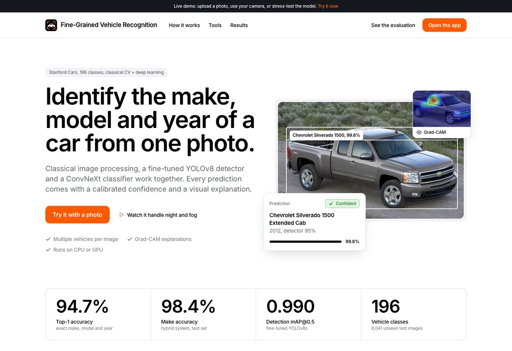
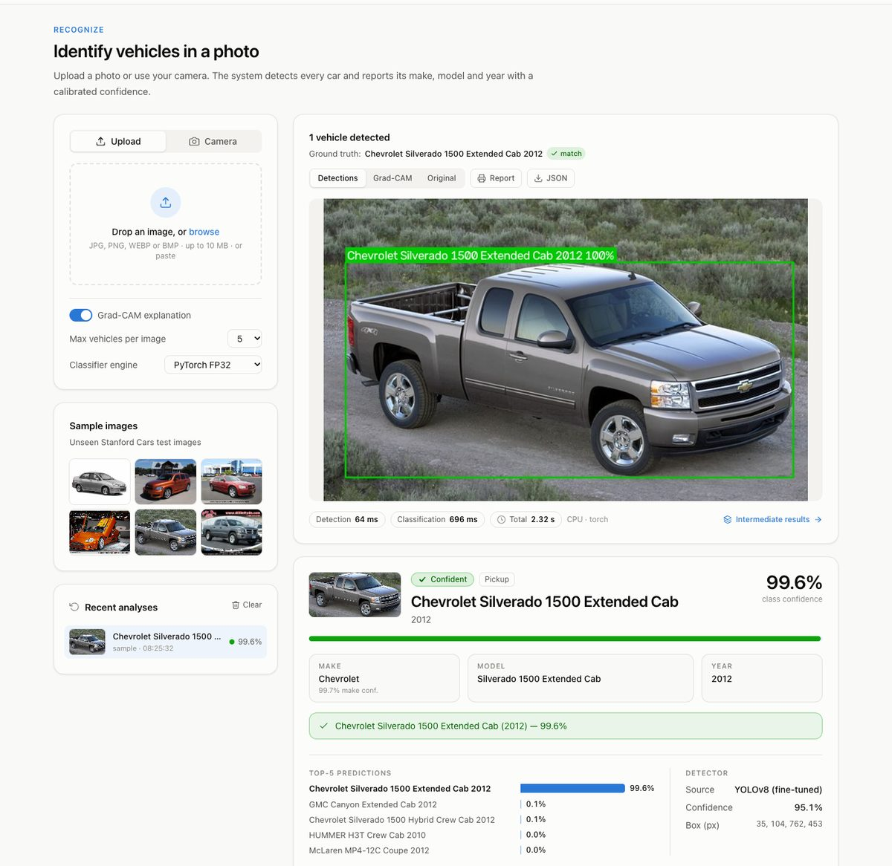
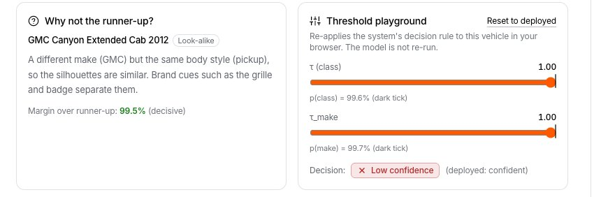
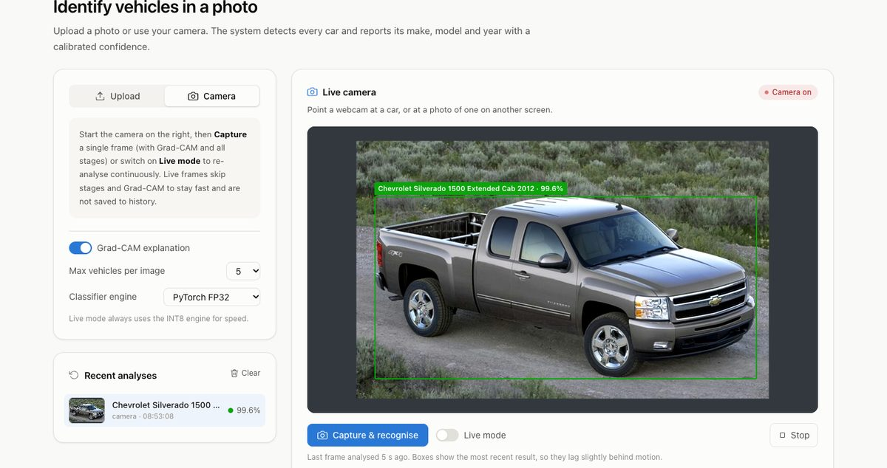
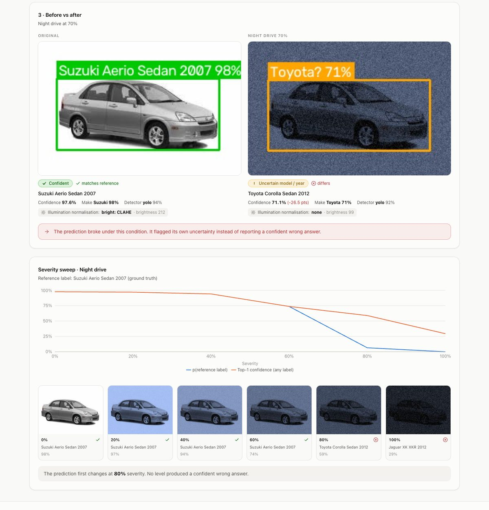
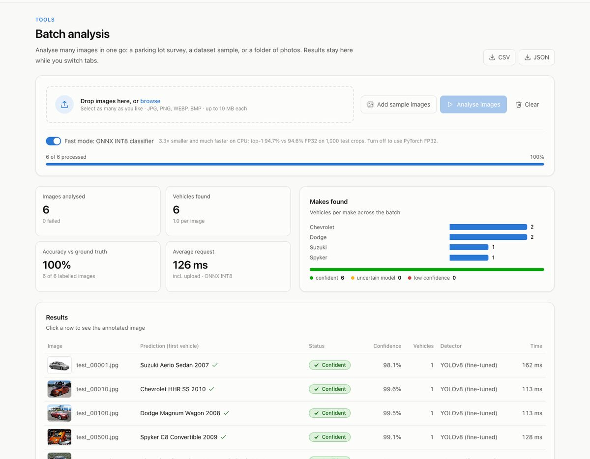
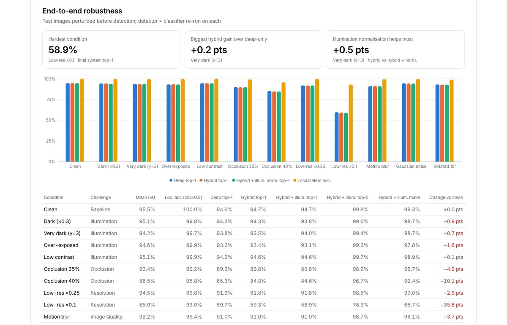
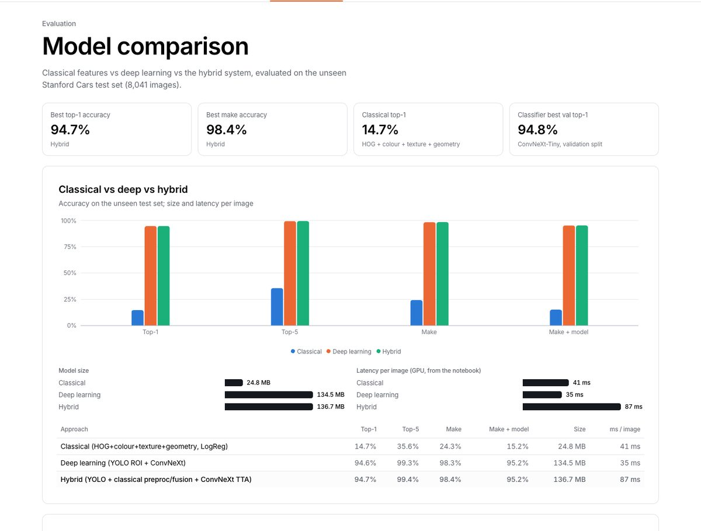
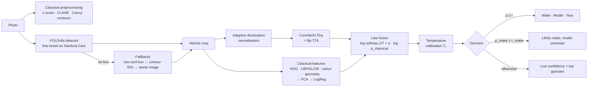

<div align="center">


# Fine-Grained Vehicle Recognition

**Identify the make, model and year of a car from a single photo: 1,291 car generations from 1948 to 2026,
plus the 196-class Stanford Cars benchmark.**
A hybrid system of classical computer vision, YOLOv8 detection and ConvNeXt classifiers, with calibrated confidence,
low-confidence handling, visual explanations and an optional vision-LLM fallback for unknown cars, served as a FastAPI + React web app.

[**Live demo**](https://harshithkt06--p5-vehicle-app-web.us-east.modal.run) ·
[Results](#results) ·
[Quick start](#quick-start) ·
[How it works](#how-it-works) ·
[API](#api) ·
[Deploy](#deploy-on-modal) ·
[**Design report**](DESIGN_REPORT_P5_T75.md) ·
[**Evaluation (eval_P5_T75)**](eval_P5_T75.md)




</div>

> The live demo scales to zero when idle, so the first request after a quiet period takes about 15 s while the models load.

---

## Results

The app serves two models through the same pipeline (switch at the top of the page):

| Model | Classes | Test set | Exact class | Make |
|---|---|---|---|---|
| **All cars** (default) | 1,291 generations, 553 models, 63 makes, 1948 to 2026 | 19,112 unseen photos | **94.4%** | **96.8%** |
| **Stanford Cars** (benchmark, hybrid) | 196 make / model / year classes, 1991 to 2012 | 8,041 unseen images | **94.7%** | **98.4%** |

### Stanford Cars benchmark model

All numbers are on the **8,041 unseen Stanford Cars test images**. Thresholds and temperatures were tuned on a separate 10% validation split.

| | Result |
|---|---|
| **Final hybrid system** | **94.7% top-1** · 99.4% top-5 · **98.4% make** · 95.2% make + model |
| Classical vs deep vs hybrid (top-1) | 14.7% → 94.6% → 94.7% |
| Vehicle detection (fine-tuned YOLOv8s) | mAP@0.5 **0.990** · mAP@0.5:0.95 0.934 · mean IoU 0.954 |
| Where the errors are | wrong year only 0.56% · same make, wrong model 3.18% · wrong make 1.59% |
| Calibration (ECE) | 13.4% raw → **1.6%** after temperature scaling (1.7% for the fused hybrid) |
| Decisions at τ = 0.90 / τ_make = 0.30 | **87.1% confident (97.8% correct)** · 12.3% make-only · 0.5% low confidence |
| Robustness (perturbed before detection) | dark 93.8% · very dark 94.0% · over-exposed 93.1% · rotated 15° 92.8% · 25% / 40% occlusion 89.8% / 84.6% · ×0.25 / ×0.1 resolution 91.8% / 58.9% |
| Optimisation | ONNX INT8: **34 MB vs 112 MB (3.3× smaller)**, top-1 94.7% vs 94.6% (1,000 test crops); classification ≈ 70 ms vs ≈ 650 ms on a laptop CPU |

The hybrid's gain over the deep model alone is small (+0.04 pt top-1 and +0.11 pt make accuracy on clean images; within ±0.5 pt of
deep-only under perturbations). Its value is in the classical fallbacks, interpretable intermediate results and calibrated decisions,
not raw accuracy. The full numbers, ablations and plots are in the app's *Model comparison*, *Robustness & confidence* and
*Failure analysis* pages, and in [`artifacts/metrics.json`](artifacts/metrics.json).

### All-cars model (1948 to 2026)

The Stanford Cars classes stop at 2012, so a second classifier was trained to recognise newer cars. Same backbone (ConvNeXt-Tiny,
ImageNet-22k), same detector, crop, illumination fix, flip TTA, temperature calibration and decision rule. All numbers are on
**19,112 test photos the model never saw**; the split keeps every photo of the same car (same photographer, same day) on one side,
so near-copies cannot leak from training into the test set.

| | Result |
|---|---|
| **Test accuracy** | **94.4% exact generation** · 97.0% top-5 · **96.8% make** · 95.1% model (any generation) · macro F1 0.931 |
| By launch year of the generation | before 1990 90.2% · 1990s 92.8% · 2000s 94.8% · 2010s 94.9% · **2020 and newer 96.9%** · **2023 and newer 97.4%** |
| Calibration (ECE) | 10.4% raw → **0.2%** after temperature scaling (T = 0.751) |
| Decisions at τ = 0.91 / τ_make = 0.30 | **89.7% confident (99.1% correct)** · 8.3% make-only · 2.1% low confidence |
| Optimisation (one crop, 2 CPU threads) | ONNX INT8 **34.8 MB vs 115.3 MB**, **33 ms vs 68 ms**, same answer as FP32 on 99.5% of test crops |
| Recent-car samples in the app | 12 / 12 right (Ford Explorer 2020+, Lexus GX 2024+, Ioniq 5, Cybertruck, BMW M4 G82, …) |
| Training | 20 epochs on one **H100**, 64 min of GPU time, **$5.74 total** on Modal (GPU benchmark, data prep, smoke tests and training) |

**Data.** 182,903 photos: Wikimedia Commons street and show photos from the
[timdwms/us-car-models-1948-2026](https://huggingface.co/datasets/timdwms/us-car-models-1948-2026) dataset (each photo keeps its own
Creative Commons licence; only photos that passed its quality filter, generations with at least 30 of them), plus 1,297 Stanford Cars
*training* photos for 14 makes the Commons set lacks (Ferrari, Lamborghini, Bentley, Rolls-Royce, Aston Martin, McLaren, Bugatti and
others). The Stanford test set was not used, so the benchmark numbers above stay fair.

**Why an H100.** Every GPU on Modal was timed on the same training step, counting the CPU cores and memory the run also pays for.
The fastest GPU was also the cheapest per training image:

| GPU | Training images / s | $ / hour (with 8 CPU, 24 GB) | **$ per 1M images** |
|---|---|---|---|
| H100 | 1,462 | 4.52 | **0.86** |
| A100 40 GB | 766 | 2.67 | 0.97 |
| L40S | 695 | 2.52 | 1.01 |
| A10 | 348 | 1.67 | 1.34 |
| L4 | 217 | 1.37 | 1.75 |
| T4 | 156 | 1.16 | 2.06 |

**Limits.** The list is mostly US-market. India-only models (Maruti Suzuki, Tata, Mahindra) are not in it: in a check with 8 such
photos, the model marked every one as low confidence instead of giving a confident wrong answer. For those cases the app can ask a
vision LLM (below).

**Submission documents (P5 · Team T75):**
- [`DESIGN_REPORT_P5_T75.md`](DESIGN_REPORT_P5_T75.md) ([PDF](DESIGN_REPORT_P5_T75.pdf)): design document with the architecture diagram, classical and deep design choices, ablation, failure cases, limitations and ethics.
- [`docs/architecture.svg`](docs/architecture.svg): the system architecture diagram on its own.
- [`eval_P5_T75.md`](eval_P5_T75.md): every evaluation metric, in the order the problem statement lists them.

---

## Features

### Recognize
Upload, drag-and-drop or paste a photo, or pick a sample. Every detected vehicle gets **make · model · year**, a calibrated confidence,
a decision status (*confident* / *uncertain model* / *low confidence*), the top-5 alternatives, the detector source (with fallbacks
flagged), a crop of the vehicle and a **Grad-CAM** heat-map. Results export as a printable PDF report or JSON.



### Vision-LLM fallback for unknown cars (optional)
When the trained model's confidence is **low**, which usually means the car is not in its class list (for example a Tata Nexon or
a Mahindra Bolero), the app sends only that car's crop to a vision LLM on Nebius and shows its answer as the main result, with the
trained model's guess underneath. For other results a button asks for the same second opinion on demand. The LLM is clearly
labelled, is never used for any metric, runs only when `NEBIUS_API_KEY` is configured, never runs on live-camera frames, asks once
per car, and is rate-limited per server. The LLM was chosen by a bake-off ([`docs/llm_bakeoff.md`](docs/llm_bakeoff.md)): 14 of the
30 models on the Nebius key accept images, and on 30 Indian-market cars `meta-models/muse-spark-open` named every exact model
(30/30, plus 18/18 US and Stanford cars, about 3.6 s per call), ahead of DeepSeek-V4.1-Flash (26/30), MiniMax-M3 (24/30) and
Gemma 3 27B (22/30). It is the default, with Gemma as the fallback.

### Explanations on every result
- **Why not the runner-up?** Explains the closest rival (a different year of the same model, a sibling model, or a look-alike from another brand) and the margin.
- **Threshold playground.** Drag τ and τ_make and watch the decision change, using the same rule as the deployed pipeline.



### Live camera
Point a webcam (or a phone, on the hosted HTTPS site) at a car and boxes and labels are drawn over the live video. Live frames use the
fast INT8 classifier.



### Stress lab
Degrade a photo in the browser: under/over-exposure, night, low contrast, fog, blur, CCTV low-res, sensor noise, occlusion or camera
tilt. Then compare before vs after, and **sweep severity 0 → 100%** to find where the prediction breaks and whether the system flags
its own uncertainty instead of failing silently.



### Batch analysis
Drop many images and get a queue with progress and ETA, a summary (makes found, decision mix, accuracy against ground truth) and **CSV / JSON export**.



### Evaluation dashboards
Model comparison (classical vs deep vs hybrid, ablation, detection, training curves, optimisation), robustness and confidence
(12 perturbation conditions, slices, ECE, reliability, risk–coverage), failure analysis (error hierarchy, most-confused pairs,
cause tagging, Grad-CAM gallery), an **All-cars model** page (accuracy by era, training curve, GPU choice, calibration, decisions,
CPU speed, most-confused pairs and a gallery of confident mistakes with photo credits), a coverage catalogue of both models'
classes, and a requirement checklist.

<p>


</p>

---

## How it works



| Stage | Details |
|---|---|
| **Classical CV** | Aspect-preserving resize, per-channel z-score, adaptive gamma + CLAHE on LAB lightness, auto-threshold Canny, morphological closing, contour analysis and a contour-based vehicle ROI. Features: HOG (shape), LBP + GLCM (texture), HSV/LAB statistics (colour), aspect ratio, solidity, circularity, Hu moments, left–right symmetry (geometry). |
| **Detection** | YOLOv8s pretrained on COCO and fine-tuned on Stanford Cars boxes. If it finds nothing, the pipeline falls back to the best low-confidence box, then the classical contour ROI, then the whole image. |
| **Classification** | ConvNeXt-Tiny (ImageNet-22k pretrained, `timm`) fine-tuned for 20 epochs on padded vehicle crops at 288 px, with flip test-time augmentation. |
| **Hybrid fusion** | Classical features → standardise → PCA(256) → logistic regression, late-fused with the CNN: `log_softmax(z/T) + α·log p_classical`, with α tuned on validation. |
| **Calibration and decisions** | Temperatures T and T₂ fitted on validation. Thresholds τ / τ_make chosen on validation for 99% / 98% accuracy on accepted predictions. |
| **Optimisation** | FP16, ONNX FP32, ONNX dynamic INT8 quantisation and L1 pruning were benchmarked. The app serves FP32 (for Grad-CAM) and INT8 (for speed). |

**Dataset.** [Stanford Cars](https://ai.stanford.edu/~jkrause/cars/car_dataset.html): 16,185 images, 196 classes at make / model / year level,
one bounding box per image. It has no number-plate annotations or video, so licence-plate reading and vehicle tracking are out of scope.
Anything outside the 196 classes is mapped to the closest known class, which is why the confidence handling matters.
The all-cars model uses the same pipeline with 1,291 generation classes trained on Wikimedia Commons photos (see [Results](#all-cars-model-1948-to-2026));
it has no classical fusion step (α = 0), because the hybrid gain on Stanford Cars was within noise.

---

## Quick start

**Requirements:** Python 3.10+ (tested 3.11 and 3.14), Node.js 20.19+, about 2 GB of disk. No GPU needed.

### macOS / Linux
```bash
git clone https://github.com/Harshithkt/car-evals.git && cd car-evals

python3 -m venv .venv && source .venv/bin/activate
pip install -r backend/requirements.txt
python scripts/smoke_test.py                 # loads the models, predicts the 6 sample images

uvicorn backend.app:app --reload --reload-dir backend          # API on http://localhost:8000

# second terminal
cd frontend && npm install && npm run dev    # app on http://localhost:5173
```

### Windows (PowerShell)
```powershell
git clone https://github.com/Harshithkt/car-evals.git; cd car-evals

py -m venv .venv; .venv\Scripts\Activate.ps1   # if blocked: Set-ExecutionPolicy -Scope CurrentUser RemoteSigned
pip install -r backend\requirements.txt
python scripts\smoke_test.py

uvicorn backend.app:app --reload --reload-dir backend

# second terminal
cd frontend; npm install; npm run dev
```

### Model files
The repository includes the YOLOv8 detector, the **INT8 ONNX classifier**, the classical model and all metadata, so the app runs right after cloning.

`artifacts/classifier_best.pth` and `artifacts_modern/classifier_best.pth` (the 112 MB and 115 MB PyTorch checkpoints) are over
GitHub's 100 MB file limit and are **not in the repository**. Without them, the backend automatically uses the INT8 classifiers, and
everything works except Grad-CAM. To enable PyTorch inference and Grad-CAM, put the checkpoints in those folders (the Stanford one is
exported by the training notebook, the all-cars one by `modal_train/train_modern.py`). They are picked up on the next start.

### Single server (production)
```bash
cd frontend && npm run build && cd ..
uvicorn backend.app:app --host 0.0.0.0 --port 8000      # serves the API and the built app on http://localhost:8000
```

A [`Dockerfile`](Dockerfile) builds the same single-server image (`docker build -t car-evals . && docker run -p 8000:8000 car-evals`).

---

## Configuration

| Variable | Default | Meaning |
|---|---|---|
| `BACKEND` | `torch` | Primary classifier: `torch` (PyTorch FP32, Grad-CAM) or `onnx` (INT8). Falls back to `onnx` if the PyTorch checkpoint is missing. |
| `LOAD_ONNX` | `1` | With `BACKEND=torch`, also load the INT8 classifier as a fast second engine. |
| `DEVICE` | `auto` | `auto` (CUDA if available), `cuda` or `cpu` |
| `MAX_UPLOAD_MB` | `10` | Upload size limit |
| `CORS_ORIGINS` | `http://localhost:5173,…` | Allowed browser origins |
| `WARMUP` | `1` | Run a warm-up prediction at startup |
| `ARTIFACTS_DIR`, `PLOTS_DIR`, `SAMPLES_DIR` | `./artifacts`, `./plots`, `./samples` | Data locations (Stanford Cars model) |
| `ALLCARS_DIR` | `./artifacts_modern` | The all-cars model |
| `DEFAULT_MODEL` | `allcars` | Model used when a request names none (`allcars` or `stanford`). It loads first; the other loads in the background. |
| `NEBIUS_API_KEY` | (unset) | Turns on the optional vision-LLM second opinion. Put it in a git-ignored `.env` file in the project root or export it. |
| `NEBIUS_VLM_MODEL` | auto | Vision model id; by default `meta-models/muse-spark-open` (best in [the bake-off](docs/llm_bakeoff.md)), else `google/gemma-3-27b-it` |
| `LLM_MAX_PER_HOUR` | `60` | LLM calls allowed per hour per server, so a public link cannot use up your credits |

## API

Interactive docs at `/docs` (Swagger UI).

| Method | Endpoint | Description |
|---|---|---|
| `POST` | `/api/predict?model=allcars&engine=torch&gradcam=true&stages=true&max_vehicles=5` | Multipart `file` (JPG / PNG / WEBP / BMP, ≤ 10 MB). `model` is `allcars` (default) or `stanford`. Returns `vehicles[]` (make, model, year, confidence, status, message, top-5, box, detector source), `annotated_image`, `gradcam`, `stages[]`, `classical_info`, `timings_ms`. Images are base64 data URLs. |
| `GET` | `/api/health?model=` | Status of every model (`models[]`), plus engines and thresholds of the one asked for |
| `GET` | `/api/metrics?model=` | Every evaluation result of that model |
| `GET` | `/api/classes?model=` | The model's classes (`id`, `name`, `make`, `model`, `year`; all-cars classes also carry `generation`, `start_year`, photo counts) |
| `GET` | `/api/plots`, `/api/plots/{name}?w=1400` | Evaluation plots (full PNG, or resized WebP with `w`) |
| `GET` | `/api/samples`, `/api/samples/{name}` | Sample test images with ground truth, the model they belong to and photo credits |
| `GET` | `/api/failures`, `/api/failures/{name}` | The all-cars model's most confident test mistakes, with photo credits |
| `POST` | `/api/llm-opinion` | Optional. Multipart `file` (one vehicle crop). Returns a vision LLM's guess (make, model, years, clues). Only when `NEBIUS_API_KEY` is set; rate-limited. |

```bash
curl -F file=@samples/test_00500.jpg "http://localhost:8000/api/predict?stages=false&gradcam=false"
```

---

## Deploy on Modal

[`modal_app/deploy.py`](modal_app/deploy.py) runs the whole app (API + frontend) in one **CPU-only** container on [Modal](https://modal.com):
2 cores (hard limit) + 6 GiB, **scale-to-zero** after 5 idle minutes, and at most one container. That's about $0.14 per hour while running and nothing when idle.

```bash
pip install modal && modal token new
cd frontend && npm run build && cd ..
modal deploy modal_app/deploy.py                  # → https://<workspace>--p5-vehicle-app-web.<region>.modal.run
P5_WARM=1 modal deploy modal_app/deploy.py        # keep one container warm (e.g. during a demo)
modal app stop p5-vehicle-app
```

Deployment uses the model files in your local `artifacts/` and `artifacts_modern/`, so include both `classifier_best.pth`
files if you want Grad-CAM online. If `NEBIUS_API_KEY` is in `.env` (or your environment) when you deploy, it is passed to the
container as a Modal secret and the LLM second-opinion button appears; it is never baked into the image or sent to the browser.

---

## Reproducing the evaluation

| Notebook | Purpose |
|---|---|
| [`notebook/P5_Vehicle_Recognition.ipynb`](notebook/P5_Vehicle_Recognition.ipynb) | Data preparation, classical CV, YOLOv8 fine-tuning, ConvNeXt training, hybrid fusion, ablation (Colab, T4) |
| [`notebook/P5_Evaluation_Remaining.ipynb`](notebook/P5_Evaluation_Remaining.ipynb) | Loads the trained models (no training) and computes similar-class analysis, robustness, calibration, thresholds, optimisation and failure analysis |

The evaluation notebook can also run on a Modal GPU with `modal run modal_eval/run_eval.py`, which uploads the models, executes the
notebook and downloads the results. Import its output zips with:

```bash
python scripts/import_colab_results.py            # newest P5_artifacts*.zip / P5_plots*.zip in ~/Downloads (--dry-run to preview)
```

The import backs up the current files, rejects unsafe zip paths, refuses to replace a *different* `inference.py` / `classical_cv.py`,
and reports anything still missing.

**All-cars model.** [`modal_train/train_modern.py`](modal_train/train_modern.py) does everything on Modal, step by step (each step's
command is in the file's header): GPU benchmark, data download and cropping on CPU containers (one per make, about 3 minutes), a smoke
test, then training on the GPU, which checkpoints every epoch and resumes if interrupted. It then calibrates on the validation split,
evaluates on the test split, exports ONNX INT8 and saves samples, failures and photo credits.
[`scripts/install_allcars_model.py`](scripts/install_allcars_model.py) copies the result into `artifacts_modern/`.
Spending is capped by a hard function timeout computed from the remaining budget, plus a time-based check after every epoch.

---

## Project structure

```
├── artifacts/              # Stanford Cars model: weights, config.json (thresholds), class_meta.json, metrics.json, inference pipeline
│   ├── inference.py        #   VehicleRecognizer: detection → classification → fusion → decision → Grad-CAM (runs both models)
│   └── classical_cv.py     #   classical preprocessing, edges, contours, ROI, HOG/LBP/GLCM/colour/geometry features
├── artifacts_modern/       # all-cars model (same layout): ~1,300 generations, metrics, sample and failure crops with credits
├── backend/app.py          # FastAPI: two models × two engines, upload validation, metrics/plots/samples, static frontend
├── backend/llm.py          # optional vision-LLM second opinion (Nebius, OpenAI-compatible API)
├── frontend/src/           # React 19 + Vite + TypeScript + Tailwind + Recharts
│   ├── pages/              #   Landing, Recognize, Batch, StressLab, Pipeline, AllCars, Comparison, Robustness, Failures, Catalogue, About
│   └── components/         #   VehicleCard, CameraPanel, charts, tables, UI kit
├── plots/                  # evaluation figures from the notebooks
├── samples/                # 6 unseen test images + ground truth
├── scripts/                # smoke_test.py, build_config.py, import_colab_results.py, install_allcars_model.py
├── modal_app/deploy.py     # hosting on Modal (CPU, scale-to-zero)
├── modal_eval/run_eval.py  # run the evaluation notebook on a Modal GPU
├── modal_train/            # all-cars model: GPU benchmark, data prep, training + export on Modal (train_modern.py)
├── notebook/               # training + evaluation notebooks
└── Dockerfile
```

## Troubleshooting

| Problem | Fix |
|---|---|
| Header shows "Backend offline" | Start `uvicorn backend.app:app` from the project root, then click retry. |
| No Grad-CAM / "engine onnx" only | `artifacts/classifier_best.pth` is missing; see [Model files](#model-files). |
| `InconsistentVersionWarning` for `classical_lr.joblib` | Harmless (it was saved with scikit-learn 1.6.1). For no warning, use Python ≤ 3.13 and `pip install scikit-learn==1.6.1`. |
| Error loading `yolo_car_best.pt` | `pip install -U ultralytics torch` (verified with torch 2.8–2.15 and ultralytics 8.4). |
| Port 8000 or 5173 in use | `uvicorn backend.app:app --port 8010` and `API_PROXY=http://127.0.0.1:8010 npm run dev`. |
| Camera doesn't start | Browsers allow the camera only on `localhost` or HTTPS. Use the hosted site or a USB webcam. |

## Acknowledgements

- **Stanford Cars**: J. Krause, M. Stark, J. Deng, L. Fei-Fei. *3D Object Representations for Fine-Grained Categorization.* 4th IEEE Workshop on 3D Representation and Recognition (3dRR-13), ICCV 2013. Images are from the [jhpohovey/StanfordCars-Dataset](https://github.com/jhpohovey/StanfordCars-Dataset) mirror.
- **US car models 1948-2026**: [timdwms/us-car-models-1948-2026](https://huggingface.co/datasets/timdwms/us-car-models-1948-2026) on Hugging Face (labels CC BY 4.0). The photos come from Wikimedia Commons and keep their own licences (CC BY, CC BY-SA, CC0, public domain); the sample and failure crops shipped in `artifacts_modern/` list each photo's author, licence and source page in `credits.json`, and the app shows them.
- Vision-LLM fallback: [Nebius Token Factory](https://docs.tokenfactory.nebius.com) (`meta-models/muse-spark-open` by default). Test photos for the bake-off are credited in [`docs/llm_bakeoff.md`](docs/llm_bakeoff.md).
- [Ultralytics YOLOv8](https://github.com/ultralytics/ultralytics), [timm](https://github.com/huggingface/pytorch-image-models) (ConvNeXt), [ONNX Runtime](https://onnxruntime.ai), OpenCV, scikit-image, scikit-learn, FastAPI, React, Recharts.
